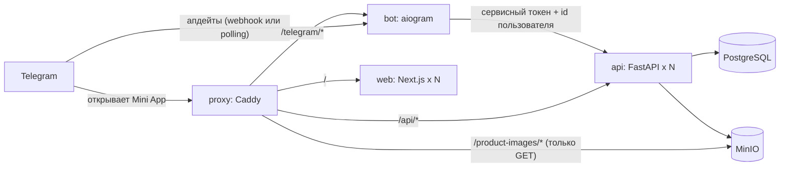

# Telegram-каталог

Каталог товаров, работающий как Telegram Mini App.

- **Бот** (aiogram 3): на `/start` и любое другое сообщение отвечает «У меня есть товар» и предлагает открыть Mini App. Администратор добавляет товар **одним сообщением: фото с названием товара в подписи**.
- **Mini App** (Next.js App Router): страница «Каталог» со списком товаров. Администраторам там же доступна форма загрузки.
- **API** (FastAPI): проверяет, что пользователь пришёл из Telegram, определяет его роль, сохраняет изображения в MinIO, а записи — в PostgreSQL.

Все сервисы приложения stateless: общее состояние хранится только в PostgreSQL и MinIO, поэтому `api` и `web` можно запускать в любом количестве реплик.

## Архитектура



Снаружи доступен только Caddy. Он распределяет запросы между репликами `api` и `web` через Docker DNS, поэтому новые реплики подхватываются автоматически. Изображения отдаются по короткоживущим presigned-ссылкам MinIO, подписанным под публичный хост и обслуживаемым с того же origin.

## Авторизация и роли

| Клиент | Заголовок `Authorization` | Как проверяется |
|---|---|---|
| Mini App | `tma <Telegram.WebApp.initData>` | HMAC-SHA256 с токеном бота по спецификации Telegram; `auth_date` не старше 24 часов (`INIT_DATA_MAX_AGE_SECONDS`) |
| Бот | `service <BOT_API_TOKEN>` + `X-Telegram-User-Id` | сравнение общего секрета за константное время |
| Только локальная разработка | `dev <telegram_id>` | принимается только при `ENVIRONMENT=development` и `DEV_AUTH_ENABLED=true`; если включить его в production, сервис не запустится |

Роль определяется API на каждом запросе: **Admin**, если проверенный Telegram ID указан в `ADMIN_TELEGRAM_IDS`, иначе **User**. Клиент роль не передаёт. Пользователи могут просматривать товары, создавать их могут только администраторы — API проверяет это даже в обход бота и интерфейса.

В обычном браузере без init data от Telegram страница показывает заголовок «Каталог» и предложение открыть её через бота. Неавторизованные запросы API отклоняет.

## Запуск

```bash
cp .env.example .env
docker compose -f docker-compose.yml up -d --build
```

Порядок старта: `postgres` и `minio` → одноразовые `minio-init` (приватный бакет и пользователь MinIO, ограниченный этим бакетом) и `migrate` (роль БД с минимальными правами, миграции Alembic, выдача привилегий) → `api` → `web`, `bot`, `proxy`.

Файл `-f docker-compose.yml` указан явно, потому что без него подключается `docker-compose.override.yml` с конфигурацией для разработки.

## Переменные окружения

Ниже описаны переменные, назначение которых неочевидно из названия. Все секреты должны быть случайными URL-safe строками (`python -c "import secrets; print(secrets.token_urlsafe(32))"`).

| Переменная | Назначение |
|---|---|
| `ADMIN_TELEGRAM_IDS` | Telegram ID через запятую, которым выдаётся роль Admin. Роль вычисляется на каждом запросе, поэтому изменение вступает в силу после перезапуска `api` и `bot` без миграций. |
| `BOT_API_TOKEN` | Общий секрет (не короче 32 символов), с которым бот обращается к API от имени пользователя. Не связан с токеном Telegram. |
| `SITE_ADDRESS` | Адрес сайта для Caddy. `:80` — обычный HTTP (TLS терминируется снаружи); доменное имя включает автоматический HTTPS с выпуском сертификатов. |
| `PUBLIC_HOST`, `PUBLIC_HTTPS` | Хост (с портом, если он нестандартный) и схема, по которым клиенты обращаются к прокси. Под этот хост подписываются presigned-ссылки на изображения, поэтому он должен быть доступен с устройства пользователя, а не только с сервера. |
| `WEBAPP_URL` | Адрес Mini App, который бот устанавливает в кнопку. Telegram принимает только `https`; при `http` бот запускается, но кнопку не устанавливает и пишет предупреждение в лог. |
| `WEBHOOK_BASE_URL` | Пусто — бот работает через long polling (только одна реплика). Публичный `https`-origin — бот регистрирует webhook на `<origin>/telegram/webhook` и может масштабироваться. |
| `WEBHOOK_SECRET` | Обязателен вместе с `WEBHOOK_BASE_URL`: 32–256 символов `A-Z a-z 0-9 _ -`. Telegram присылает его в заголовке, бот отклоняет запросы без него. |
| `MIGRATION_DB_USER`, `MIGRATION_DB_PASSWORD` | Учётная запись владельца БД. Используется только сервисом `migrate`. |
| `DB_USER`, `DB_PASSWORD` | Учётная запись с минимальными правами для реплик API. Создаётся сервисом `migrate`, вручную заводить не нужно. |
| `MINIO_APP_ACCESS_KEY`, `MINIO_APP_SECRET_KEY` | Пользователь MinIO для API с доступом только к `MINIO_BUCKET`. Создаётся `minio-init`; root-учётка (`MINIO_ROOT_*`) приложению не передаётся. |
| `ENVIRONMENT` | `production` отключает документацию API и запрещает dev-авторизацию; `development` включает `/api/docs`. |
| `DEV_AUTH_ENABLED`, `DEV_AUTH_TELEGRAM_ID` | Только для разработки: позволяет открыть каталог в обычном браузере от имени указанного Telegram ID. При `ENVIRONMENT=production` API с этим флагом не запустится. |

## HTTPS и работа внутри Telegram

Telegram открывает Mini App только по `https`. Для этого достаточно задать публичный `https`-адрес в `WEBAPP_URL`, а также `PUBLIC_HOST` и `PUBLIC_HTTPS=true`; изменения кода не требуются.

- **Локально**: `SITE_ADDRESS=:80`, перед портом прокси (`HTTP_PORT`) ставится любой HTTPS-туннель, и его хост прописывается в переменные выше. `WEBHOOK_BASE_URL` можно оставить пустым — polling работает без входящего HTTPS. После смены адреса туннеля нужно пересоздать контейнеры: `docker compose -f docker-compose.yml up -d api bot`.
- **Сервер с доменом**: `SITE_ADDRESS=<домен>`, `HTTP_PORT=80`, `HTTPS_PORT=443`, тот же домен в `PUBLIC_HOST`, `WEBAPP_URL` и `WEBHOOK_BASE_URL`, плюс `WEBHOOK_SECRET`. Caddy сам получает и продлевает сертификаты, они хранятся в томе `caddy_data`.

## Масштабирование и отказоустойчивость

```bash
docker compose -f docker-compose.yml up -d --scale api=3 --scale web=3
```

- **api**: не хранит сессий и кэшей в памяти процесса. Каждый запрос авторизуется по собственным заголовкам. Загружаемые файлы временно хранятся в tmpfs контейнера, пока MinIO их не примет. Пользователи сохраняются через `INSERT ... ON CONFLICT`, поэтому параллельные реплики не конфликтуют.
- **web**: оболочка страницы статическая, данные загружаются из API в браузере.
- **bot**: в **режиме webhook** Telegram доставляет каждый апдейт ровно одной реплике через прокси, поэтому `--scale bot=N` безопасен. Каждая реплика идемпотентно регистрирует один и тот же webhook. Long polling (пустой `WEBHOOK_BASE_URL`) предназначен для локальной разработки и требует **одного** экземпляра бота.
- **migrate** и **minio-init** — идемпотентные одноразовые задачи, их повторный запуск безопасен.

Отказоустойчивость проверяется остановкой части реплик (`docker stop catalog-api-1 catalog-web-1`): запросы продолжают обрабатываться оставшимися.

## Хранилища и монтирование

| Тип | Где | Назначение |
|---|---|---|
| Named volume | `postgres_data` → `/var/lib/postgresql/data` | пользователи и товары сохраняются между перезапусками |
| Named volume | `minio_data` → `/data` | изображения товаров сохраняются между перезапусками |
| Named volume | `caddy_data`, `caddy_config` | TLS-сертификаты и ACME-аккаунт сохраняются между перезапусками |
| tmpfs | `/tmp` в `api` (128 MB), `bot`, `web` (64 MB), `migrate`, `minio`, `minio-init`, `proxy` (16 MB) | временные файлы, удаляемые вместе с контейнером; у контейнеров приложения корневая ФС только для чтения |
| tmpfs | `shm_size: 256mb` у `postgres` | разделяемая память PostgreSQL |
| Bind mount | `./backend`, `./frontend` только в `docker-compose.override.yml` | перезагрузка кода «на лету» при разработке; в production код встроен в образы |

Тома с данными монтируют только `postgres` и `minio`, API обращается к ним по сети.

## Разработка

```bash
docker compose up -d --build      # подключает docker-compose.override.yml
```

Override запускает `uvicorn --reload` и `next dev` с примонтированными исходниками и устанавливает `ENVIRONMENT=development`. Для работы в обычном браузере используются `DEV_AUTH_ENABLED` и `DEV_AUTH_TELEGRAM_ID`.

### Тесты

```bash
cd backend  && python -m venv .venv && .venv/bin/pip install -r requirements-dev.txt && .venv/bin/pytest
cd bot      && python -m venv .venv && .venv/bin/pip install -r requirements-dev.txt && .venv/bin/pytest
cd frontend && npm ci && npm test && npm run typecheck
```

Тесты бэкенда покрывают проверку подписи Telegram (подделка данных, чужой токен бота, истёкшие и будущие даты, дублирующиеся ключи), авторизацию User/Admin, проверку сервисного токена, валидацию изображений, откат загрузки в хранилище при ошибке БД, сортировку и пагинацию, ввод в стиле SQL-инъекций и некорректные query-параметры. Тесты бота — видимость функций по ролям, разбор подписи и обработку ошибок API. Тесты фронтенда — передачу заголовков, интерфейс в зависимости от роли и состояния каталога.

## API

| Метод | Путь | Роль | Примечания |
|---|---|---|---|
| `GET` | `/api/v1/auth/me` | User, Admin | проверенный профиль и роль |
| `GET` | `/api/v1/products?limit=50&offset=0` | User, Admin | сначала новые; `limit` 1-100, `offset` 0-10000; возвращает `{items, next_offset}` |
| `POST` | `/api/v1/products` | Admin | `multipart/form-data` строго с полями `name` (1-120 символов) и `image` (JPEG, PNG или WebP, до 5 MB) |
| `GET` | `/health`, `/ready` | внутренние | liveness и readiness (БД и бакет); через прокси недоступны |

Ошибки возвращаются в формате JSON `{"detail": ...}`. При непредвиденных ошибках возвращается общее сообщение с `request_id`, совпадающим с заголовком `X-Request-ID` и записями в структурированных логах.

## Безопасность

- **SQL-инъекции**: все запросы строятся через выражения SQLAlchemy с параметрами. SQL не собирается из строк, сортировка задана на сервере. Единственный динамический DDL (создание роли и выдача прав в `app/migrate.py`) экранируется на стороне PostgreSQL через `format('%I', '%L')`.
- **Минимальные привилегии**: реплики API подключаются к БД как `DB_USER` с правами только `SELECT/INSERT/UPDATE` на `users` и `SELECT/INSERT` на `products`, без DDL. Миграции выполняются отдельной учётной записью-владельцем. Доступ к MinIO — через пользователя, ограниченного одним бакетом. Бакет приватный, прокси пропускает только подписанные `GET`/`HEAD`-запросы.
- **Загрузка файлов**: формат изображения определяется декодированием через Pillow (белый список форматов, ограничения по размеру и числу пикселей, защита от decompression bomb). Content type от клиента игнорируется. Ключи объектов — случайные UUID. Размер тела запроса ограничен на прокси.
- **Контейнеры**: непривилегированные пользователи, корневая ФС `read_only`, `cap_drop: [ALL]`, `no-new-privileges`, multi-stage образы для `backend` и `frontend` без инструментов сборки.
- **HTTP**: CSP (встраивание во фрейм разрешено только Telegram), `nosniff` и `no-store` для ответов API. В production документация API отключена. Секреты берутся только из переменных окружения, `.env` добавлен в `.gitignore`.

## Образ MinIO

В 2026 году MinIO прекратил публикацию community-образов (`minio/minio` удалён с Docker Hub, а quay.io требует авторизации). Поэтому Compose использует сборку MinIO из исходников от Chainguard, закреплённую по digest в `docker-compose.yml`. Её клиент `mc` также используется в `minio-init`. Подойдёт любой MinIO-совместимый образ — достаточно изменить якорь `x-minio-image`.
